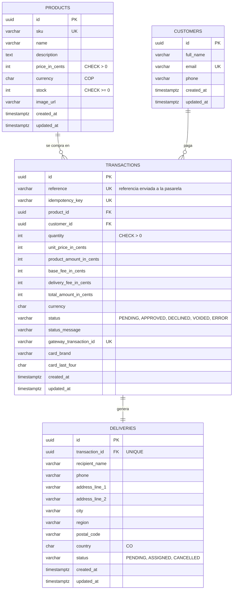

# Checkout Onboarding App

App para comprar un producto con tarjeta de crédito a través de una pasarela de pagos en **modo sandbox**: el cliente ve el producto y su stock, ingresa los datos de su tarjeta y de entrega, revisa el resumen, paga y ve el resultado. Al volver a la tienda, el stock ya está actualizado.

## Enlaces

| | |
|---|---|
| **App desplegada** | https://checkout-onboarding-web.onrender.com |
| **API — Swagger (público)** | https://checkout-onboarding-api.onrender.com/api/docs |
| **Health check** | https://checkout-onboarding-api.onrender.com/api/health |

> **Sobre AWS:** la app quedó publicada en Render y no en AWS por una restricción de la cuenta de AWS ajena al proyecto. La infraestructura de AWS está completa como código. Ver [¿Por qué no está en AWS?](#por-qué-no-está-en-aws).

**Para probar el pago** (sandbox, no se cobra nada): tarjeta `4242 4242 4242 4242` para un pago **aprobado** o `4111 1111 1111 1111` para uno **rechazado**, con cualquier fecha futura, cualquier CVC de 3 dígitos y cualquier nombre.

## Contenido

- [Stack](#stack)
- [Flujo de la app](#flujo-de-la-app)
- [Arquitectura del backend](#arquitectura-del-backend)
- [Modelo de datos](#modelo-de-datos)
- [API](#api)
- [Frontend](#frontend)
- [Seguridad y manejo de datos sensibles](#seguridad-y-manejo-de-datos-sensibles)
- [Tests y cobertura](#tests-y-cobertura)
- [Despliegue](#despliegue)
- [Correr el proyecto localmente](#correr-el-proyecto-localmente)
- [Cómo se trabajó](#cómo-se-trabajó)

## Stack

| Capa | Tecnología |
|---|---|
| Frontend | React 19 + TypeScript, Redux Toolkit + redux-persist, Vite, CSS Modules (flexbox y grid) |
| Backend | NestJS 11 + TypeScript, TypeORM, class-validator, Joi, Swagger |
| Base de datos | PostgreSQL 16 |
| Tests | Jest (frontend y backend), Testing Library, supertest |
| CI | GitHub Actions: lint, typecheck, tests con umbral de cobertura, build, migraciones contra PostgreSQL real |
| Infraestructura | Render Blueprint ([`render.yaml`](render.yaml)) y Terraform para AWS ([`infra/`](infra/)) |

## Flujo de la app

La app sigue los 5 pasos del proceso de negocio:

```
1. Producto  →  2. Tarjeta y entrega (modal)  →  3. Resumen (backdrop)  →  4. Resultado  →  5. Producto con el stock actualizado
```

1. **Producto:** nombre, descripción, precio, unidades disponibles y selector de cantidad (máximo 5 por pedido, sin pasar el stock).
2. **Tarjeta y entrega:** al tocar *Pagar con tarjeta de crédito* se abre un modal accesible que pide la tarjeta (con detección de **VISA** y **Mastercard**, Luhn, fecha y CVC) y los datos de entrega, con validación en cada campo.
3. **Resumen:** un *backdrop* al estilo Material muestra el valor del producto, la tarifa base (siempre se cobra) y el costo de envío, con el botón de pago.
4. **Pago y resultado:**
   1. El backend crea la transacción en **PENDING**, reserva el stock y devuelve el número de transacción.
   2. Llama a la pasarela de pagos para hacer el cobro con la tarjeta tokenizada.
   3. Cuando el pago termina (aprobado o fallido), actualiza la transacción, asigna la entrega y confirma o libera el stock.
5. **Regreso a la tienda:** la pantalla de resultado vuelve sola a la tienda, que muestra el stock actualizado.

**Si el usuario recarga la página** en cualquier paso, la app retoma donde iba: el paso, el producto, la cantidad, los datos de entrega y la transacción en curso (si estaba pendiente, vuelve a consultar su estado). Los datos de la tarjeta **no** se guardan, a propósito (ver [Seguridad](#seguridad-y-manejo-de-datos-sensibles)).

## Arquitectura del backend

**Hexagonal (puertos y adaptadores).** Cada módulo separa tres capas, y la lógica de negocio nunca vive en los controllers:

```
backend/src/
├── products/        transactions/      customers/      deliveries/      payments/
│   ├── domain/            → entidades, reglas y puertos (interfaces). Sin dependencias de Nest ni TypeORM
│   ├── application/       → casos de uso: orquestan el dominio a través de los puertos
│   └── infrastructure/    → adaptadores: controllers HTTP, DTOs, repositorios TypeORM, cliente de la pasarela
├── shared/          → Result (ROP), AppError y su mapeo a HTTP
├── database/        → migraciones, seed y preparación de la BD al arrancar
└── config/          → validación de variables de entorno (Joi) y opciones de la BD
```

**Railway Oriented Programming.** Los casos de uso devuelven un `Result<T, AppError>` (`Ok` / `Err`) y encadenan pasos con `map`, `andThen` y `andThenAsync`. Si un paso falla, el resto se salta y el error llega al controller, que lo traduce a un código HTTP en un solo lugar:

| `AppError` | HTTP |
|---|---|
| `NOT_FOUND` | 404 |
| `VALIDATION` | 422 |
| `CONFLICT` (sin stock, pedido duplicado) | 409 |
| `UNAUTHORIZED` (firma del webhook inválida) | 401 |
| `PAYMENT_GATEWAY` | 502 |
| `GATEWAY_UNAVAILABLE` (timeout o 5xx de la pasarela) | 503 |
| `UNEXPECTED` | 500 |

**Decisiones pensadas para situaciones reales:**

- **Reserva atómica de stock.** Al crear la transacción PENDING, el stock se descuenta con un `UPDATE ... WHERE stock >= cantidad` dentro de una transacción de BD. Dos clientes no pueden comprar la última unidad al mismo tiempo; el segundo recibe 409. Si el pago falla, las unidades se devuelven.
- **Liquidación única e idempotente.** Una transacción solo pasa de PENDING a su estado final una vez, aunque el resultado llegue por varios caminos a la vez (consulta a la pasarela y webhook).
- **Header `Idempotency-Key`.** Si el cliente reenvía el mismo pedido (doble clic, reintento por red), recibe la misma transacción en vez de pagar dos veces. Reutilizar la llave con otro pedido devuelve 422.
- **Timeouts de la pasarela.** Un timeout no significa que el cobro falló: la transacción queda PENDING y se recupera después consultando la pasarela por `reference`, nunca se marca como rechazada a ciegas.
- **Consulta del estado con tiempo máximo.** Tras crear el pago, el backend consulta el estado final con un límite total de tiempo, para no dejar la petición colgada.
- **Webhook firmado** en `POST /api/webhooks/payment-events`. Valida la firma del evento (SHA-256 con el secreto de eventos, comparación en tiempo constante) y liquida las transacciones que hayan quedado pendientes. La cuenta sandbox del reto es compartida y pide no modificarla, así que el webhook no está registrado en su panel; está cubierto con tests de eventos firmados.

## Modelo de datos



- **Montos en centavos (enteros)** para no perder precisión con decimales. La transacción guarda una copia del precio unitario y de cada tarifa, así el registro no cambia si el precio del producto cambia después.
- **Clientes por email:** un cliente que vuelve a comprar se reconoce por su email y sus datos se actualizan.
- **De la tarjeta solo se guardan la marca y los últimos 4 dígitos.**
- **Entrega 1 a 1 con la transacción:** se crea en PENDING junto con la transacción, pasa a ASSIGNED si el pago se aprueba y a CANCELLED si falla.
- **Restricciones en la BD** (`CHECK`, `UNIQUE`, llaves foráneas) como segunda línea de defensa además de la validación de la API.
- Todo el esquema se crea con **migraciones** de TypeORM ([`backend/src/database/migrations`](backend/src/database/migrations)); el seed carga 3 productos de prueba y es idempotente (no duplica ni reinicia el stock).

## API

Documentación interactiva completa en **[Swagger](https://checkout-onboarding-api.onrender.com/api/docs)**. Todas las rutas llevan el prefijo `/api`.

| Método | Ruta | Para qué |
|---|---|---|
| `GET` | `/health` | Estado de la API y de la conexión a la BD |
| `GET` | `/products` | Productos con su stock |
| `GET` | `/products/{id}` | Un producto |
| `GET` | `/quotes?productId=&quantity=` | Desglose del cobro (producto, tarifa base, envío, total) calculado en el servidor |
| `GET` | `/payments/acceptance-tokens` | Términos de la pasarela que el cliente debe aceptar antes de pagar |
| `POST` | `/transactions` | Crea la transacción (PENDING), cobra y devuelve el resultado. Acepta `Idempotency-Key` |
| `GET` | `/transactions/{id}` | Estado de una transacción (resuelve las que quedaron pendientes) |
| `GET` | `/customers/{id}` | Datos del cliente, **enmascarados** |
| `GET` | `/deliveries/{id}` | Datos de la entrega, **enmascarados** |
| `POST` | `/webhooks/payment-events` | Eventos firmados de la pasarela |

Validaciones principales: el body se valida con `class-validator` (los campos desconocidos se rechazan), la cantidad va de 1 a 5 y no puede superar el stock, los montos siempre se calculan en el servidor (el cliente nunca envía precios) y el email, el teléfono y la dirección tienen formato y longitud controlados.

## Frontend

```
frontend/src/
├── app/         → store de Redux, persistencia y hooks tipados
├── features/    → products, checkout, payment, summary, transaction (slice + componentes + tests)
├── shared/      → cliente HTTP, componentes de UI (Modal, Backdrop, TextField) y utilidades
└── config/      → variables públicas (VITE_*)
```

- **Redux Toolkit con arquitectura Flux:** las vistas despachan acciones, los reducers son funciones puras y los efectos (llamadas a la API) viven en thunks.
- **Persistencia:** con redux-persist solo se guarda el slice `checkout` (paso, producto, cantidad, datos de entrega y la transacción), versionado y con migración, sobre un storage que no rompe la app si el navegador lo bloquea.
- **Mobile first:** diseñado desde 375 × 667 (iPhone SE) y probado también en horizontal (667 × 375); en pantallas grandes los productos pasan a varias columnas. Solo flexbox y grid, sin frameworks de CSS.
- **Accesibilidad:** el modal atrapa el foco, el fondo queda `inert`, se cierra con Escape y los errores están asociados a cada campo.

## Seguridad y manejo de datos sensibles

- **El backend nunca ve la tarjeta.** El frontend la tokeniza directamente con la llave **pública** de la pasarela y al backend solo le llega el token, la marca y los últimos 4 dígitos.
- **Los datos de la tarjeta no se persisten.** El número, la fecha y el CVC viven solo en la memoria del formulario; por eso, al recargar la página, se conservan los datos de entrega pero hay que volver a escribir la tarjeta. Guardar el CVC está prohibido por PCI DSS.
- **Las llaves privadas viven solo en el servidor**, como variables de entorno validadas al arrancar. No están en el repositorio ni en el bundle del navegador.
- **Firma de integridad** en cada cobro (SHA-256 de referencia + monto + moneda + secreto), calculada en el backend.
- **Datos personales enmascarados** en las respuestas de clientes y entregas.
- **Cabeceras de seguridad:** helmet en la API y cabeceras equivalentes en el sitio estático. CORS limitado al dominio del frontend.
- **Base de datos privada:** en el despliegue no acepta conexiones externas, solo la de la API.

## Tests y cobertura

Todos los tests están escritos con **Jest**. El reto pide más de 80 % de cobertura; el CI falla si frontend o backend bajan de ese umbral.

### Frontend: 192 tests en 21 suites

| Statements | Branches | Functions | Lines |
|---|---|---|---|
| **100 %** (572/572) | **100 %** (330/330) | **100 %** (174/174) | **100 %** (490/490) |

Reducers y thunks de Redux, validaciones de tarjeta y entrega, componentes con Testing Library (interacción real: escribir, hacer clic, recargar el estado) y el cliente HTTP.

### Backend: 247 tests

| Statements | Branches | Functions | Lines |
|---|---|---|---|
| **100 %** (895/895) | **88,67 %** (329/371) | **100 %** (194/194) | **100 %** (772/772) |

| Suite | Tests | Qué prueba |
|---|---|---|
| Unitarios | 214 en 34 suites | Dominio, casos de uso (ROP), adaptadores, controllers, DTOs, configuración y mapeo ORM |
| E2E | 26 en 5 suites | Endpoints HTTP reales con supertest: códigos de estado, validación de los bodies, webhook firmado |
| Integración | 7 en 1 suite | El repositorio contra **PostgreSQL real**: reserva atómica de stock con pedidos concurrentes, liquidación única, idempotencia |

**Sobre las ramas del backend:** las 42 ramas sin cubrir no son lógica de la aplicación. Las genera TypeScript al compilar los decoradores de NestJS y TypeORM (`emitDecoratorMetadata`), del tipo `typeof X !== "undefined" ? X : Object`, una por cada parámetro o propiedad decorada. Nunca se ejecutan, así que no se pueden cubrir con tests. Toda la lógica escrita a mano está cubierta al 100 %.

```bash
# Frontend
cd frontend && npm run test:cov

# Backend
cd backend
npm run test:cov        # unitarios con cobertura
npm run test:e2e        # endpoints HTTP
docker compose up -d    # (desde la raíz) PostgreSQL para la integración
npm run test:int        # repositorio contra PostgreSQL
```

## Despliegue

**La app está desplegada en Render** y definida como código en [`render.yaml`](render.yaml) (Blueprint):

| Recurso | Detalle |
|---|---|
| `checkout-onboarding-db` | PostgreSQL 16 sin acceso externo (solo la red privada de Render) |
| `checkout-onboarding-api` | La API en Docker ([`backend/Dockerfile`](backend/Dockerfile)), siempre encendida (plan Starter) y con health check en `/api/health`. Al arrancar aplica las migraciones y el seed de forma idempotente |
| `checkout-onboarding-web` | El frontend como sitio estático en CDN, con cabeceras de seguridad |

Las llaves de la pasarela se cargan en el panel de Render (`sync: false`) y nunca pasan por el repositorio.

### ¿Por qué no está en AWS?

El reto recomienda AWS, así que la primera opción fue AWS y **toda la infraestructura está escrita como código** en [`infra/`](infra/) con Terraform:

| Pieza | Recurso de AWS |
|---|---|
| Base de datos | PostgreSQL 16 administrado en Lightsail, privado, con backups y contraseña aleatoria |
| API | Lightsail Container Service con la misma imagen Docker y health check en `/api/health` |
| Frontend | S3 privado (Origin Access Control) detrás de CloudFront, con cabeceras de seguridad |
| Un solo dominio HTTPS | CloudFront enruta `/api/*` a la API, así el navegador no necesita CORS |

El código está validado en CI ([`infra-ci.yml`](.github/workflows/infra-ci.yml): `terraform fmt` y `validate`, shellcheck de los scripts y build de la imagen) y `terraform plan` genera los 11 recursos sin errores. Todo se despliega con un solo comando: `./infra/scripts/deploy.sh`.

**Qué pasó.** La cuenta de AWS es nueva y quedó dentro de una organización administrada por AWS con una política de control de servicios (SCP) que niega la creación de recursos. Así respondió AWS al aplicar Terraform:

```
AccessDeniedException: User: arn:aws:iam::<cuenta>:user/checkout-deployer is not authorized to perform:
lightsail:CreateRelationalDatabase ... with an explicit deny in a service control policy
```

El mismo rechazo apareció para `s3:CreateBucket`, `lightsail:CreateContainerService`, CloudFormation (por eso no se usó CDK), EC2, RDS, Lambda y ECR. Un *explicit deny* en una SCP no se puede saltar desde la cuenta, ni siquiera con permisos de administrador.

**Qué se hizo para resolverlo:**

1. Se eligieron servicios que la restricción inicialmente permitía leer (Lightsail, S3 y CloudFront) y Terraform en lugar de CDK, que depende de CloudFormation.
2. Se pasó la cuenta del plan gratuito al **plan de pago** el 15 de noviembre de 2026, con presupuesto y límite de gasto configurados. La consola muestra la cuenta como de pago, pero la SCP siguió negando las mismas acciones.
3. Se abrió un **caso con AWS Support** el 16 de noviembre de 2026 para que retiren la restricción. Al momento de la entrega sigue sin resolverse.

**Por qué Render.** El reto permite *"any Cloud provider"*. Para que la app quedara publicada y funcionando a tiempo se usó Render, también con infraestructura como código ([`render.yaml`](render.yaml)) y la **misma imagen Docker**. No se cambió nada del código de la aplicación para eso. Si la cuenta de AWS se habilita, la app se publica en AWS con `./infra/scripts/deploy.sh`, sin tocar código. Detalles en [`infra/README.md`](infra/README.md).

## Correr el proyecto localmente

Requisitos: Node 22, Docker.

```bash
# 1. Base de datos (PostgreSQL en el puerto 5433)
docker compose up -d

# 2. Backend → http://localhost:3000/api  (Swagger en /api/docs)
cd backend
cp .env.example .env     # completar las llaves del sandbox
npm install
npm run db:setup         # migraciones + seed
npm run start:dev

# 3. Frontend → http://localhost:5173
cd frontend
cp .env.example .env.local   # URL de la API y llave PÚBLICA de la pasarela
npm install
npm run dev
```

## Cómo se trabajó

- **Una rama y un pull request por feature** (`feature/backend-products`, `feature/frontend-card-delivery-modal`, `feature/backend-payment-webhook`, `fix/modal-focus-trap`, etc.), cada uno con su CI en verde antes del merge.
- **IA como asistente de desarrollo:** se usó Claude Code (CLI) para analizar el reto, proponer la arquitectura, escribir código y tests, y revisar cada PR contra los requisitos (con ayuda de un MCP de revisión de PRs). Cada cambio se revisó y se probó antes de integrarlo, y varias revisiones encontraron bugs reales que se corrigieron con su test: un timeout de la pasarela que se interpretaba como pago rechazado, una consulta de estado que podía tardar casi dos minutos y el foco que se escapaba del modal.
